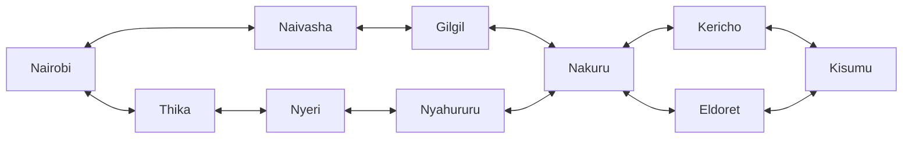
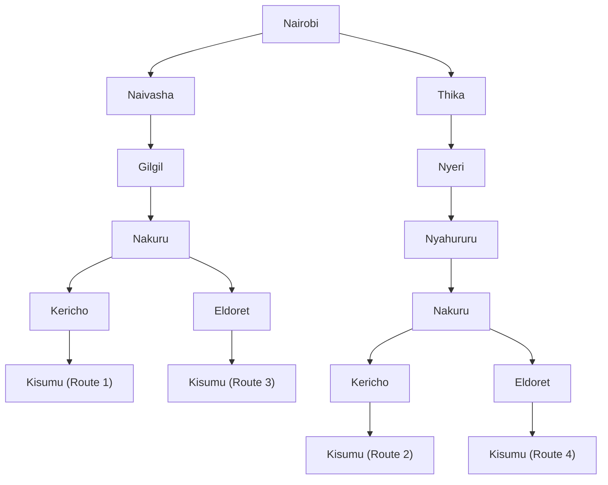

# Practical Exercise 3: Designing a Searching Agent

## Question 1: Self-Driving Trailer Agent

### PEAS Framework

| Component | Description |
|---|---|
| **Performance measure** | Safe delivery of goods, minimum travel distance and time, fuel efficiency, compliance with traffic regulations, collision avoidance, timely arrival |
| **Environment** | Kenya's highway network: roads, towns, junctions, roundabouts, traffic lights, road signs, pedestrians, other vehicles, roadworks, weather, obstacles, delivery destinations |
| **Actuators** | Steering, accelerator, brakes, gear control, indicators, headlights, horn |
| **Sensors** | GPS, cameras (road signs and lanes), radar/LiDAR (obstacles), speed and wheel sensors, weather/visibility sensors |

### Environment Properties

| Property | Classification | Justification |
|---|---|---|
| **Observability** | Partially observable | Other vehicles can block the agent's view and fog reduces visibility, so it never has complete information. |
| **Determinism** | Stochastic | Other drivers behave unpredictably, traffic changes, and obstacles can appear. |
| **Episodic / Sequential** | Sequential | Each decision affects later ones, e.g. choosing a road determines the next junction and the total distance. |
| **Static / Dynamic** | Dynamic | Traffic, pedestrians, weather and road conditions change during the journey. |
| **Discrete / Continuous** | Continuous | Speed, acceleration, steering angle, position and time vary continuously. |

---

## Question 2: Directed Graph and Search Tree

### Abstraction of the Highway Network

Selected towns are modelled as **nodes** and the roads between them as **edges**. The model covers Nairobi, the Central Highlands, the Rift Valley and the Lake Victoria Basin. Minor roads and details not needed for route planning are excluded.

### Figure 1: Directed Graph

Double-headed arrows show that travel in both directions is allowed.



*Figure 1: Directed graph of the selected Kenyan highway connections.*

### Figure 2: Search Tree

The tree expands from the initial state (Nairobi) to the goal state (Kisumu). Repeated town names are separate paths through the network.



*Figure 2: Search tree showing the alternative paths from Nairobi to Kisumu.*

---

## Question 3: Optimal Route from Nairobi to Kisumu

### Path Cost Function

The cost of a route is the sum of the road distances between consecutive towns:

```
C(R) = d1 + d2 + ... + dn
```

where `di` is the distance of the i-th road segment and `n` is the number of segments in route `R`.

### Road-Distance Data

Distances come from the assignment's distance calculator.

| No. | Road Segment | Distance (km) |
|---:|---|---:|
| 1 | Nairobi – Naivasha | 76.60 |
| 2 | Naivasha – Gilgil | 26.90 |
| 3 | Gilgil – Nakuru | 36.77 |
| 4 | Nakuru – Kericho | 88.70 |
| 5 | Kericho – Kisumu | 65.83 |
| 6 | Nairobi – Thika | 38.96 |
| 7 | Thika – Nyeri | 70.83 |
| 8 | Nyeri – Nyahururu | 82.68 |
| 9 | Nyahururu – Nakuru | 48.39 |
| 10 | Nakuru – Eldoret | 126.15 |
| 11 | Eldoret – Kisumu | 89.96 |

### Route Calculations

**Route 1:** Nairobi → Naivasha → Gilgil → Nakuru → Kericho → Kisumu

```
C(R1) = 76.60 + 26.90 + 36.77 + 88.70 + 65.83 = 294.80 km
```

**Route 2:** Nairobi → Thika → Nyeri → Nyahururu → Nakuru → Kericho → Kisumu

```
C(R2) = 38.96 + 70.83 + 82.68 + 48.39 + 88.70 + 65.83 = 395.39 km
```

**Route 3:** Nairobi → Naivasha → Gilgil → Nakuru → Eldoret → Kisumu

```
C(R3) = 76.60 + 26.90 + 36.77 + 126.15 + 89.96 = 356.38 km
```

**Route 4:** Nairobi → Thika → Nyeri → Nyahururu → Nakuru → Eldoret → Kisumu

```
C(R4) = 38.96 + 70.83 + 82.68 + 48.39 + 126.15 + 89.96 = 456.97 km
```

### Comparison of Route Costs

| Route | Path | Total Distance (km) |
|---|---|---:|
| **Route 1** | Via Naivasha, Gilgil, Nakuru, Kericho | **294.80** |
| Route 3 | Via Naivasha, Gilgil, Nakuru, Eldoret | 356.38 |
| Route 2 | Via Thika, Nyeri, Nyahururu, Nakuru, Kericho | 395.39 |
| Route 4 | Via Thika, Nyeri, Nyahururu, Nakuru, Eldoret | 456.97 |

### Optimal Route

```
294.80 < 356.38 < 395.39 < 456.97
```

**Route 1** is the shortest at **294.80 km**. It is 61.58 km shorter than Route 3, 100.59 km shorter than Route 2, and 162.17 km shorter than Route 4.

The self-driving trailer should therefore select Route 1: **Nairobi → Naivasha → Gilgil → Nakuru → Kericho → Kisumu**.

> **Note:** This is the shortest of the candidate routes in the simplified model, not necessarily the shortest among every possible route in Kenya.

---

## Group Work Evidence

- **Group 9 members:**

  | Admission No. | Name |
  |---|---|
  | 184540 | Onwenga Francis Bosire |
  | 192077 | Ogero Mark Otinga |
  | 189720 | Kirwa Kipchumba Brian |

- **Evidence of collaboration:** 


